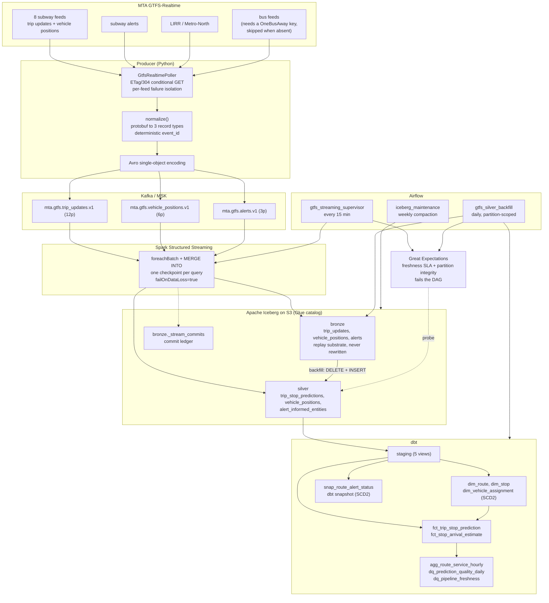

# Real-Time NYC Transit Lakehouse

Streams MTA GTFS-Realtime feeds through Kafka into an Apache Iceberg lakehouse,
with Spark Structured Streaming, dbt, Airflow, Great Expectations and Terraform.

Every number below comes from a command in this repo. What has not been verified
is listed in [docs/limitations.md](docs/limitations.md).

| | Command | Result |
|---|---|---|
| Python tests | `make test` | 411 passed |
| of which boot Spark and write real Iceberg | `pytest -m "spark or iceberg"` | 42 |
| dbt project | `make dbt-build` | 188 nodes, 0 failures (14 models, 1 snapshot, 5 seeds, 168 tests) |
| Throughput | `make bench` | 2,003 events/sec against a 2,000 target; ceiling 56,704/sec |
| Terraform | `make tf-validate` | `fmt -check` and `validate` clean, per module too |
| Airflow DAGs | `make airflow-check` | 3 DAGs, 12 tasks, no import errors |
| Lint | `make lint` | ruff and black clean |

Nothing here has been applied to a cloud account. See
[what runs locally vs. what needs AWS](#what-runs-locally-vs-what-needs-aws).

## Architecture



A Python service polls the MTA's GTFS-Realtime protobuf endpoints, normalizes
each `FeedMessage` into three record types (stop-level trip predictions, vehicle
positions, service alerts) and publishes them to Kafka as Avro with a
deterministic `event_id` derived from the business key. Spark Structured
Streaming consumes each topic and, inside one `foreachBatch`, maintains both its
Iceberg bronze table and its silver projection with an idempotent `MERGE INTO`,
so an at-least-once replay produces exactly-once effects. dbt builds staging
views, dimensions (including a hand-rolled SCD2 vehicle-assignment dimension and
a dbt snapshot of route service status), two facts at two grains, and quality
marts. Airflow supervises the stream, runs partition-scoped backfills gated by
Great Expectations freshness SLAs, and runs weekly Iceberg maintenance.
Terraform describes the MSK, S3, Glue and IAM footprint.

## Quickstart

### Run the tests (no Kafka, no AWS, no MTA key)

```bash
git clone https://github.com/husseinmohab/nyc-transit-lakehouse.git
cd nyc-transit-lakehouse
make venv          # python3.12 venv, dev deps, editable install
make test          # 411 tests including Spark and Iceberg, about a minute
```

The Spark tests fetch the Iceberg runtime jar from Maven on first run (~120 MB,
cached in `~/.ivy2`). They skip cleanly when pyspark or the jar is unavailable,
so the pure-Python half of the suite needs neither a JVM nor a network.

### Reproduce the throughput benchmark

```bash
make bench            # 2,000 events/sec for 30s, no broker needed
make bench-ceiling    # unthrottled, to find this machine's limit
```

`make bench` exits non-zero when a throttled run achieves under 95% of target,
so it is an assertion rather than a number to eyeball. Measured figures and
method: [docs/benchmark.md](docs/benchmark.md).

### Build the dbt project

```bash
make deps             # dbt deps (dbt_utils)
make dbt-build        # seed + build: 14 models, 1 snapshot, 168 tests
make dbt-count-tests  # prints the test count straight from the manifest
```

Runs against DuckDB over committed seeds, so no warehouse is needed. The seeds
are generated from the committed GTFS-RT fixture by
`scripts/generate_dbt_seeds.py`, and CI fails if they drift from the generator.

### Bring up the local stack

```bash
make up           # Kafka (KRaft) + MinIO + topics + the streaming job
make up-airflow   # also Postgres and Airflow
make up-tools     # also Kafka UI
```

| Service | URL |
|---|---|
| Kafka | `localhost:9092` from the host, `kafka:29092` in-network |
| MinIO console | <http://localhost:9001> (minioadmin / minioadmin) |
| Airflow | <http://localhost:8080> (admin / admin) |
| Kafka UI | <http://localhost:8085> |

Then replay synthetic load, or poll the real MTA:

```bash
docker compose -f docker/docker-compose.yml --profile bench run --rm loadgen
docker compose -f docker/docker-compose.yml --profile live up -d producer
```

The subway and commuter-rail feeds have needed no API key since 2023. The NYC
bus feeds still require a OneBusAway key; without one they are skipped, not
faked.

### Inspect without running anything

```bash
make show-ddl     # every CREATE TABLE and ALTER ... WRITE ORDERED BY
make feeds        # which GTFS-RT feeds would be polled, as JSON
```

## Layout

```
src/nyc_transit/            5,500 lines
├── config.py               env-driven settings; an empty env runs locally
├── gtfs/
│   ├── feeds.py            13 MTA endpoints, key gating, feed groups
│   ├── decoder.py          protobuf decode with explicit failure modes
│   ├── normalize.py        FeedMessage to 3 record types, deterministic event_id
│   ├── nyct.py             NYCT extension, degrades to nulls
│   ├── static_reference.py 26 real routes, 60 real stations
│   └── synthetic.py        feed generator for the load gen and fixtures
├── producer/
│   ├── poller.py           the polling service
│   ├── sink.py             Kafka / memory / null sinks behind one protocol
│   ├── loadgen.py          closed-loop throughput benchmark
│   └── cli.py              gtfs-producer
├── schemas/
│   ├── avro/*.avsc         3 schemas, documented field by field
│   └── registry.py         Avro single-object encoding and compatibility rules
├── streaming/
│   ├── ddl.py              Iceberg DDL as pure functions
│   ├── dedup.py            the MERGE, dedup and partition-delete SQL
│   ├── writer.py           the idempotent foreachBatch writer
│   ├── transforms.py       Kafka to bronze to silver, PySpark
│   ├── reference.py        the same projection in plain Python
│   ├── session.py          SparkSession for local, MinIO and Glue
│   └── jobs.py             3 streaming queries and a CLI
├── quality/
│   ├── freshness.py        SLA definitions and evaluation
│   ├── expectations.py     GE suites compiled from the SLAs
│   └── probe.py            Iceberg to observations
└── backfill/partitions.py  partition-scoped idempotent rebuild

dbt/nyc_transit/            1,750 lines of SQL
├── models/staging/         5 views plus source freshness
├── models/marts/core/      dim_route, dim_stop, dim_vehicle_assignment (SCD2),
│                           route_alert_status, 2 facts, 1 aggregate
├── models/marts/quality/   dq_pipeline_freshness, dq_prediction_quality_daily
├── snapshots/              snap_route_alert_status (dbt snapshot, SCD2)
├── macros/                 cross-adapter shims and SCD2 helpers
├── tests/singular/         15 hand-written assertions
└── seeds/                  5 CSVs, generated and drift-checked in CI

infra/                      1,500 lines of HCL
└── modules/{s3_lakehouse,msk,glue_catalog,iam}/

airflow/dags/               supervisor, backfill, maintenance
airflow/plugins/            task callables (unit-testable, lazy imports)

tests/                      4,300 lines
├── unit/                   9 files: transforms, SCD2 SQL, dedup, schemas, SLAs
├── integration/            3 files: Spark, Iceberg exactly-once, dbt smoke
└── fixtures/               committed GTFS-RT protobuf plus a truncated one

docker/      compose stack and 2 Dockerfiles
.github/     ci.yml (6 jobs) and terraform.yml (2 jobs)
docs/        exactly_once.md, data_model.md, benchmark.md, limitations.md
```

## Where each resume claim lives

**Streamed MTA GTFS-Realtime feeds (~2K events/sec) through Kafka into an Apache
Iceberg lakehouse on S3.**
[gtfs/feeds.py](src/nyc_transit/gtfs/feeds.py) (13 endpoints) to
[producer/poller.py](src/nyc_transit/producer/poller.py) to
[producer/sink.py](src/nyc_transit/producer/sink.py) to
[streaming/jobs.py](src/nyc_transit/streaming/jobs.py) to
[streaming/ddl.py](src/nyc_transit/streaming/ddl.py). Throughput is reproducible
with `make bench` (2,003 events/sec measured). "On S3" is configured for S3 and
MinIO but exercised only against MinIO and the local filesystem.

**Spark Structured Streaming jobs with exactly-once semantics.**
[streaming/writer.py](src/nyc_transit/streaming/writer.py) and
[streaming/dedup.py](src/nyc_transit/streaming/dedup.py). The guarantee is
at-least-once delivery with idempotent keyed application, which gives
exactly-once effects. The argument is in
[docs/exactly_once.md](docs/exactly_once.md), and 24 tests in
[test_iceberg_exactly_once.py](tests/integration/test_iceberg_exactly_once.py)
write a real Iceberg warehouse and replay batches, including with the commit
ledger disabled.

**SCD Type 2 dimensions via dbt with 40+ tests.**
[dim_vehicle_assignment.sql](dbt/nyc_transit/models/marts/core/dim_vehicle_assignment.sql),
a hand-rolled incremental SCD2 with `[valid_from, valid_to)` intervals,
NULL-safe change detection and four invariant tests, plus
[snap_route_alert_status.sql](dbt/nyc_transit/snapshots/snap_route_alert_status.sql),
a real dbt snapshot. Both exist because they answer different questions;
[docs/data_model.md](docs/data_model.md) explains which tool fits which source.
The count is 168, not 40 (`make dbt-count-tests`).

**Provisioned infrastructure (MSK, Glue, IAM) with Terraform.**
[infra/](infra/): 4 modules, 1,500 lines, `fmt -check` and `validate` clean.
"Provisioned" overstates it, because it has never been applied. Code only.

**CI/CD via GitHub Actions.** [.github/workflows/](.github/workflows/): 8 jobs
across 2 workflows (lint, tests, seed drift, dbt build and an idempotency
re-run, compose config, DAG import, Terraform fmt/validate, tflint).

**Great Expectations enforced freshness SLAs on idempotent Airflow backfills.**
[quality/freshness.py](src/nyc_transit/quality/freshness.py),
[quality/expectations.py](src/nyc_transit/quality/expectations.py) and
[gtfs_backfill_dag.py](airflow/dags/gtfs_backfill_dag.py). 43 tests cover the
SLA logic and the GE suites, and the backfill's idempotency is tested against
real Iceberg. The DAGs are import-checked, not executed.

## Design notes

**The delivery guarantee is stated as it is.** Exactly-once here means
exactly-once effects, achieved with a deterministic `event_id` (a blake2b hash
of the business key, joined on `\x1f` so part boundaries cannot collide) and a
`MERGE INTO` guarded by a strict `>` on an event-time version column. Strict,
not `>=`: with `>=` a replay rewrites every matched row and emits a delete file
plus a data file per micro-batch for no change. Event-time, not processing-time:
a processing-time version always wins on replay, which is what idempotence rules
out. Full argument: [docs/exactly_once.md](docs/exactly_once.md).

**Bronze is never rewritten.** It is the replay substrate: once a bad silver
transform ships, bronze turns permanent data loss into a ten-minute backfill.
`guard_target_table()` enforces that in code, and `partition_delete_sql()`
validates every partition value as an ISO date, since that function builds a
`DELETE`.

**The backfill replaces partitions rather than merging them.** A MERGE-based
backfill cannot remove a row that should not exist, so a bug that over-produced
yesterday would survive it.
`test_backfill_removes_rows_that_should_no_longer_exist` injects a row bronze
cannot justify and asserts it is gone.

**The silver projection is written three times**: PySpark for streaming, pure
SQL for the batch backfill (so it runs with no Python dependency and can be
audited from a SQL console), and plain Python as both the differential-test
oracle and the seed generator. Three differential tests keep them identical.

**Avro single-object encoding instead of Confluent Schema Registry.**
Confluent's framing needs a live registry to decode anything, which means a
fifth container locally and a CI dependency on a running service. Single-object
encoding (`0xC3 0x01` plus an 8-byte CRC-64-AVRO fingerprint) gives the property
that matters, that a consumer can tell which schema wrote a message from the
bytes alone, with no service. The framing is pinned against the Avro spec's own
`"null"` test vector using an independently implemented CRC-64.

**Partitioned on the GTFS service date**, in America/New_York with a 3 a.m.
cutover, not a UTC date, which would split every night's service across two
partitions.

**Bronze and silver are maintained by one streaming query.** Iceberg's streaming
read cannot see MERGE output without being told to skip overwrite snapshots,
which would drop the merged rows, so chaining a second stream off bronze is only
safe for an append-only table and bronze is not one. One checkpoint also means
one replay unit.

**The tests found four real bugs during development**, each now a regression
test: the synthetic generator emitted duplicates that were not byte-identical
(so dedup was never exercised); it reported one vehicle twice per message, which
is physically impossible and a grain violation; it re-randomised each trip's
stop path every poll, making prediction-churn metrics constant; and
`stop_resolved` conflated "cancellation, no stop" with "stop did not join",
which permanently depressed join coverage. Two were caught by dbt grain tests
and two by the dbt smoke test.

## What runs locally vs. what needs AWS

Verified locally:

| | How |
|---|---|
| 411 Python tests, including real Spark and Iceberg writes | `make test` |
| 2,000 events/sec through the full encode path | `make bench` |
| dbt: 14 models, 1 snapshot, 168 tests on DuckDB | `make dbt-build` |
| Incremental idempotency (same partition twice) | CI job `dbt` |
| Kafka, MinIO, Spark, Airflow, Postgres | `make up-airflow` |
| Iceberg warehouse on MinIO over `s3a://` | compose `spark-streaming` |
| Real MTA subway feeds, no key | compose `live` profile |
| Terraform fmt and validate, per module | `make tf-validate` |
| Airflow DAG import | `make airflow-check` |

Not verified, needs AWS credentials:

| | Why |
|---|---|
| `terraform apply` | Never run. `validate` checks syntax, types and wiring, not quotas, IAM evaluation or MSK broker/subnet arithmetic. |
| MSK | Never provisioned. Sizing is reasoned from the measured 0.43 MB/s. |
| Glue Data Catalog | `GlueCatalog` is configured but never exercised. Lake Formation enforcement would need extra grants. |
| S3 | `s3a://` is configured for MinIO; S3-specific behaviour is untested. |
| IAM least-privilege split | Designed, never evaluated. Expect to add an action or two on a first apply. |
| `dbt --target spark` | Never run; all dbt verification is DuckDB. |
| Airflow DAG execution | Import-checked only; the task bodies need Spark, Iceberg and MSK. |

Detail, scope decisions and known rough edges:
[docs/limitations.md](docs/limitations.md).

## Documentation

| Document | Contents |
|---|---|
| [docs/exactly_once.md](docs/exactly_once.md) | The delivery guarantee link by link, and what is not guaranteed. |
| [docs/data_model.md](docs/data_model.md) | Grain of every table, lineage, both SCD2 implementations, Iceberg properties. |
| [docs/benchmark.md](docs/benchmark.md) | How to reproduce the throughput claim, measured numbers, what it does not prove. |
| [docs/limitations.md](docs/limitations.md) | Verified against unverified, scope decisions, rough edges. |
| [.github/workflows/README.md](.github/workflows/README.md) | What each CI job proves. |
| [tests/fixtures/README.md](tests/fixtures/README.md) | Why the fixture is synthetic and how it stays honest. |

## Make targets

`make help` lists all 34. The ones that matter: `venv`, `test`, `lint`, `bench`,
`dbt-build`, `up`, `up-airflow`, `tf-validate`, `check` (everything CI runs),
`clean`.

## Requirements

Python 3.11+ (3.12 recommended), JDK 17 for pyspark, Docker for the local stack,
Terraform 1.6+ for `tf-validate`.

Dependencies are split by concern (`base`, `spark`, `dbt`, `quality`,
`airflow`), because Airflow only resolves against its own constraints file and
mixing that with pyspark, dbt and great-expectations in one resolution produces
an unbootable scheduler.

## License

MIT, see [LICENSE](LICENSE).
