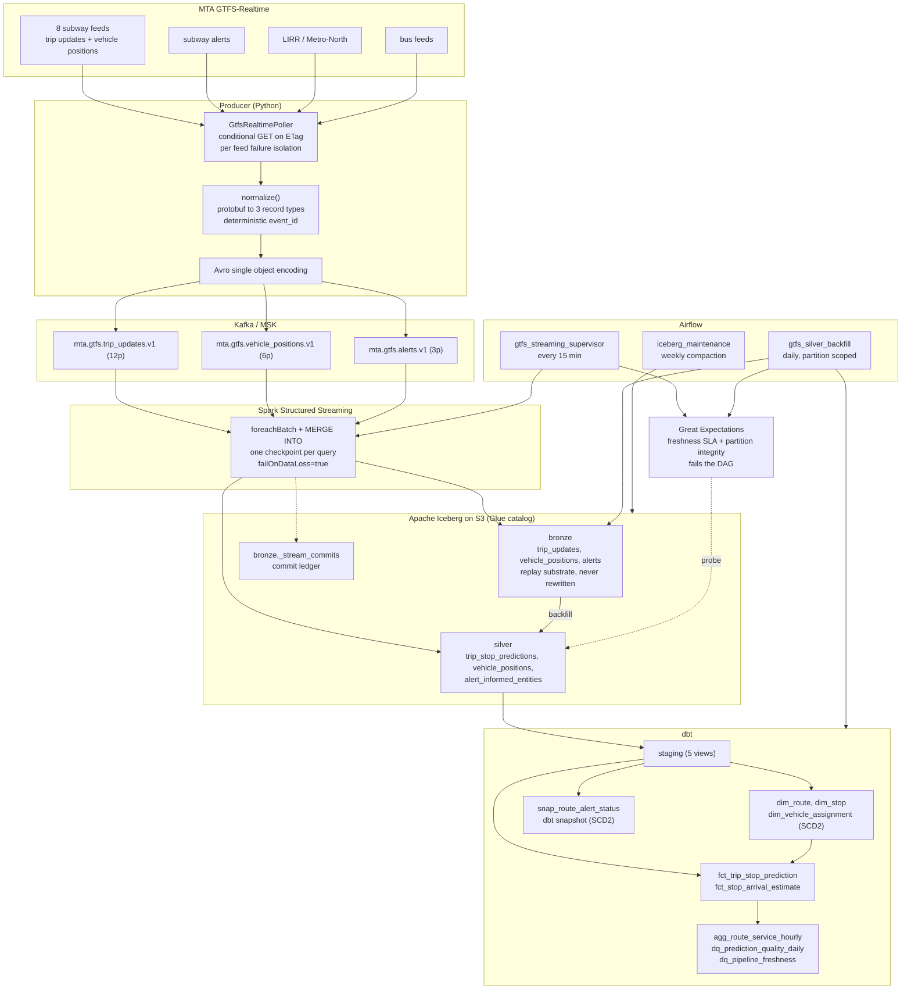

# Real-Time NYC Transit Lakehouse

[](https://github.com/husseinmohab/nyc-transit-lakehouse/actions/workflows/ci.yml)

Streams MTA GTFS-Realtime feeds through Kafka into an Apache Iceberg lakehouse on
S3, with Spark Structured Streaming, dbt, Airflow, Great Expectations and
Terraform.

## Architecture



## How it works

A Python service polls the MTA's GTFS-Realtime protobuf endpoints and normalizes
each `FeedMessage` into three record types: stop level trip predictions, vehicle
positions and service alerts. Records go to Kafka as Avro with a deterministic
`event_id` hashed from the business key, so re polling an unchanged feed produces
byte identical records.

Spark Structured Streaming consumes each topic and, inside one `foreachBatch`,
maintains both the Iceberg bronze table and its silver projection with an
idempotent `MERGE INTO`. Delivery is at least once and application is idempotent
and keyed, so a replayed micro batch is a no op and the tables converge. Bronze
is never rewritten, which makes it the replay substrate: a bad silver transform
is a ten minute backfill rather than lost data.

dbt builds staging views, dimensions including a hand rolled SCD2 vehicle
assignment dimension and a dbt snapshot of route service status, two facts at two
grains, and quality marts. Airflow supervises the stream, runs partition scoped
backfills gated by Great Expectations freshness SLAs, and runs weekly Iceberg
compaction. Terraform under `infra/` provisions MSK, S3, the Glue catalog and
three least privilege IAM roles.

## Performance

The load generator runs the production path end to end: build a `FeedMessage`,
serialize to protobuf, decode, normalize, Avro encode, hand to a sink. It is not
a loop over pre built dicts, so the figure is the rate this code turns feed bytes
into Kafka ready records.

Apple M4, 10 cores, 16 GB, Python 3.12, single process:

| Run | Target | Achieved | Throughput |
|---|---|---|---|
| `--target-eps 2000` | 2,000/s | **2,003/s** (100.2%) | 0.43 MB/s |
| `--target-eps 0` | unthrottled | **56,704/s** | 12.1 MB/s |
| `--target-eps 0 --serialization json` | unthrottled | **83,985/s** | 68.5 MB/s |

Avro averages about 215 bytes per record against JSON's 855. JSON encodes roughly
1.5x faster per record but costs 4x the bytes, paid again on every Kafka write,
every replication hop and every S3 read, so Avro is the default.

A record is one stop level arrival or departure prediction, which is the grain
the lakehouse stores. One poll of one subway feed expands to roughly 2,000 to
6,000 of these, since each trip carries 8 to 24 downstream stop predictions.

Reproduce it:

```bash
make bench            # 2,000 events/sec for 30s, no broker needed
make bench-ceiling    # unthrottled, this machine's limit
make bench-kafka      # end to end into the local broker
```

`make bench` exits non zero if a throttled run lands under 95% of target, so it
asserts the number instead of printing it. Method and full results are in
[docs/benchmark.md](docs/benchmark.md).

## Quickstart

```bash
git clone https://github.com/husseinmohab/nyc-transit-lakehouse.git
cd nyc-transit-lakehouse
make venv     # python3.12 venv, dev deps, editable install
make test     # pytest, including the Spark and Iceberg tests
```

The Spark tests fetch the Iceberg runtime jar from Maven on first run, about
120 MB, cached in `~/.ivy2`.

Build the dbt project against DuckDB over the committed seeds, so no warehouse is
needed:

```bash
make deps        # dbt deps
make dbt-build   # seed then build: models, the snapshot and every test
```

Bring up the local stack:

```bash
make up           # Kafka (KRaft) + MinIO + topics + the streaming job
make up-airflow   # also Postgres and Airflow
make up-tools     # also Kafka UI
```

| Service | URL |
|---|---|
| Kafka | `localhost:9092` from the host, `kafka:29092` in network |
| MinIO console | <http://localhost:9001> (minioadmin / minioadmin) |
| Airflow | <http://localhost:8080> (admin / admin) |
| Kafka UI | <http://localhost:8085> |

Then replay synthetic load, or poll the real MTA:

```bash
docker compose -f docker/docker-compose.yml --profile bench run --rm loadgen
docker compose -f docker/docker-compose.yml --profile live up -d producer
```

The subway and commuter rail feeds have needed no API key since 2023. The NYC bus
feeds still require a OneBusAway key; without one they are skipped rather than
faked.

Inspect without running anything:

```bash
make show-ddl   # every CREATE TABLE and ALTER ... WRITE ORDERED BY
make feeds      # which GTFS-RT feeds would be polled, as JSON
make help       # all 34 targets
```

## Deploying to AWS

`infra/` is four Terraform modules: `s3_lakehouse`, `msk`, `glue_catalog` and
`iam`. MSK uses SASL/IAM so the producer and the Spark jobs authenticate with the
same task role they use for S3 and Glue, and no Kafka password exists anywhere.

```bash
cd infra
cp terraform.tfvars.example terraform.tfvars   # set vpc_id and private_subnet_ids
terraform init
terraform plan
terraform apply
terraform output env_file_preview               # env settings for the services
```

Point the services at it by switching the catalog:

```bash
export LAKEHOUSE_CATALOG_TYPE=glue
export LAKEHOUSE_WAREHOUSE=s3://<bucket>/warehouse
export KAFKA_BOOTSTRAP_SERVERS=$(terraform -chdir=infra output -raw msk_bootstrap_brokers_sasl_iam)
export KAFKA_SECURITY_PROTOCOL=SASL_SSL
export KAFKA_SASL_MECHANISM=AWS_MSK_IAM
```

dbt switches target with `dbt build --target spark`; the models are unchanged.

## Requirements

Python 3.11 or newer (3.12 recommended), JDK 17 for pyspark, Docker for the local
stack, Terraform 1.6 or newer for `infra/`.

Dependencies are split by concern (`base`, `spark`, `dbt`, `quality`, `airflow`)
because Airflow only resolves against its own constraints file, and mixing that
with pyspark, dbt and great-expectations in one resolution produces an unbootable
scheduler.

## License

MIT, see [LICENSE](LICENSE).
