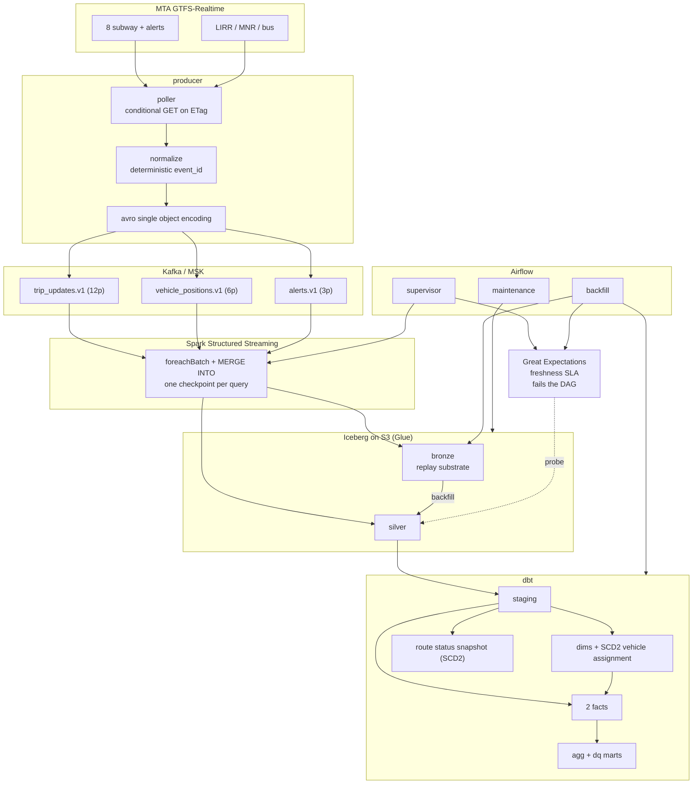

# Real-Time NYC Transit Lakehouse

[](https://github.com/husseinmohab/nyc-transit-lakehouse/actions/workflows/ci.yml)

MTA GTFS-Realtime feeds to Kafka to Apache Iceberg on S3
Spark Structured Streaming, dbt, Airflow, Great Expectations, Terraform

Runs on AWS, live feeds through MSK over SASL/IAM into Iceberg on S3 through
the Glue catalog

## architecture



## how it works

- producer polls the GTFS-RT endpoints, conditional GET on ETag
- `event_id` is a blake2b hash of the business key so a repoll of an unchanged
  feed is byte identical
- the nyct extension is compiled from vendored protos by `make proto`, which is
  what makes `nyct_train_id` the unit identity on a feed that sends no gtfs
  vehicle descriptor
- one `foreachBatch` writes bronze and its silver projection, both `MERGE INTO`
  keyed on `event_id`
- at least once delivery plus idempotent keyed apply so a replayed batch is a
  no op
- bronze is never rewritten which makes it the replay substrate
- dbt adds staging, dims, 2 facts at 2 grains, quality marts
- SCD2 twice, hand rolled for vehicle assignment and a dbt snapshot for route
  status
- Airflow supervises the stream, runs partition scoped backfills gated by Great
  Expectations freshness SLAs, compacts Iceberg weekly

grain, table properties and design notes in
[docs/data_model.md](docs/data_model.md)

## benchmarks

the load generator runs the production path
build FeedMessage, protobuf, decode, normalize, avro encode, sink
not a loop over prebuilt dicts

Apple M4, 10 cores, 16 GB, Python 3.12, single process

| run | target | achieved | throughput |
|---|---|---|---|
| `--target-eps 2000` | 2,000/s | **2,003/s** (100.2%) | 0.43 MB/s |
| `--target-eps 0` | unthrottled | **56,704/s** | 12.1 MB/s |
| `--target-eps 0 --serialization json` | unthrottled | **83,985/s** | 68.5 MB/s |

avro is ~215 bytes per record against JSON 855
JSON encodes ~1.5x faster and costs 4x the bytes, paid again on every Kafka
write, replication hop and S3 read

a record is one stop level prediction
one poll of one subway feed expands to 2,000 to 6,000 of them

```bash
make bench            # 2,000 events/sec for 30s, no broker
make bench-ceiling    # unthrottled
make bench-kafka      # end to end into the local broker
```

`make bench` exits non zero under 95% of target so it asserts the number
method and full results in [docs/benchmark.md](docs/benchmark.md)

## tests

430 pytest, 168 dbt
CI runs lint, pytest, dbt parse + compile + build, terraform fmt + validate,
Airflow DAG import, seed drift, and a double partition run for idempotency

## quickstart

```bash
make venv     # venv, dev deps, editable install
make test     # pytest including Spark and Iceberg
make deps
make dbt-build   # dbt on DuckDB over the committed seeds, no warehouse needed
```

Spark tests fetch the Iceberg jar from Maven on first run, ~120 MB, cached in
`~/.ivy2`

local stack

```bash
make up           # Kafka (KRaft) + MinIO + topics + streaming job
make up-airflow   # also Postgres and Airflow
make up-tools     # also Kafka UI
```

| service | url |
|---|---|
| Kafka | `localhost:9092` host, `kafka:29092` in network |
| MinIO | <http://localhost:9001> (minioadmin / minioadmin) |
| Airflow | <http://localhost:8080> (admin / admin) |
| Kafka UI | <http://localhost:8085> |

feed it

```bash
docker compose -f docker/docker-compose.yml --profile bench run --rm loadgen
docker compose -f docker/docker-compose.yml --profile live up -d producer
```

subway and commuter rail need no API key
NYC bus needs a OneBusAway key and is skipped without one

```bash
make show-ddl   # every CREATE TABLE and ALTER ... WRITE ORDERED BY
make feeds      # feeds that would be polled, as JSON
make help
```

## deploying to aws

modules
`s3_lakehouse` `msk` `glue_catalog` `iam` `vpc` `athena` `test_host`

MSK is SASL/IAM only so there is no Kafka password anywhere and no public broker
endpoint, clients run in the VPC

```bash
cd infra
cp terraform.tfvars.example terraform.tfvars   # create_network, or your own vpc_id
terraform init
terraform apply
terraform output env_file_preview
```

```bash
PREFIX=$(terraform -chdir=infra output -raw glue_database_prefix)
export LAKEHOUSE_CATALOG_TYPE=glue
export LAKEHOUSE_WAREHOUSE=s3://<bucket>/warehouse
export LAKEHOUSE_BRONZE_NAMESPACE=${PREFIX}_bronze
export LAKEHOUSE_SILVER_NAMESPACE=${PREFIX}_silver
export KAFKA_BOOTSTRAP_SERVERS=$(terraform -chdir=infra output -raw msk_bootstrap_brokers_sasl_iam)
export KAFKA_SASL_MECHANISM=AWS_MSK_IAM
export KAFKA_AWS_REGION=us-east-1
```

```bash
python -m nyc_transit.streaming.jobs --create-tables --load-static
SPARK_DRIVER_MEMORY=4g python -m nyc_transit.streaming.jobs --job bronze_trip_updates
```

dbt runs the same models on athena, no cluster and no JVM

```bash
export DBT_ATHENA_WORKGROUP=$(terraform -chdir=infra output -raw athena_workgroup)
export DBT_ATHENA_S3_STAGING_DIR=$(terraform -chdir=infra output -raw athena_results_uri)
DBT_ATHENA_SCHEMA=${PREFIX}_marts DBT_SNAPSHOT_SCHEMA=${PREFIX}_snapshots \
  dbt build --target athena --vars "{glue_db_prefix: $PREFIX, silver_schema: ${PREFIX}_silver}"
```

the `spark_session` target is still there for a cluster that already exists
the dbt snapshot does not run on it, see
[docs/data_model.md](docs/data_model.md)

gotchas, detail in [docs/data_model.md](docs/data_model.md)
- namespaces must be the real Glue database names
- the driver needs more than its 1 GB default or the Kafka admin client OOMs
- point `SPARK_LOCAL_DIRS` at the EBS volume, `/tmp` is a RAM backed tmpfs
- the iceberg runtime is pinned at 1.10.2, 1.7.1 crashes the jvm on a
  vectorized parquet read
- static tables come from `--load-static` on the spark path, `dbt seed` on the
  athena path
- teardown needs the buckets emptied first, `force_destroy` is unset on purpose

run on AWS
9 live feeds through MSK into Iceberg on S3 through Glue, then 14 dbt models,
the snapshot and 165 dbt tests on athena with 2 expected warnings

## requirements

Python 3.11+, JDK 17 for pyspark, Docker for the local stack, Terraform 1.6+

deps split by concern (`base` `spark` `dbt` `quality` `airflow`)
Airflow only resolves against its own constraints file and mixing that with
pyspark and dbt in one resolution gives an unbootable scheduler

## license

MIT
